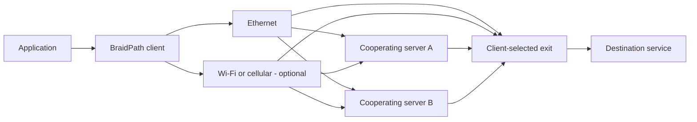

# BraidPath

The UDP tunnel on `main` also includes an opt-in [independent bulk FEC
extension](docs/independent-fec.md): `--fec 16 --fec-repairs 2` with explicit
mixed FEC. Existing single-repair defaults remain unchanged; this is not a
public-network performance or reliable-delivery guarantee.

**Weave paths. Repair loss. Keep latency in check.**

[](https://github.com/LiuTangLei/braidpath/actions/workflows/ci.yml)
[](LICENSE)

[简体中文](README.zh.md) · [Run it](docs/runtime.md) · [Architecture](docs/architecture.md) · [Carrier design](docs/transports.md) · [Validation plan](docs/validation.md) · [Roadmap](docs/roadmap.md)

BraidPath is a Rust multipath transport project combining **forward error correction (FEC), client interface aggregation, and nearby relay entrances**. Its goal is to adapt throughout a long-running session: combine independent path capacity when routes are clear, and preserve useful low-latency delivery when routes become congested.

“Braid” means weaving several imperfect paths into a more resilient connection.

> **Status: experimental v0.5.3 development.** TCP proxying now uses the aggregate DATAGRAM engine while retaining main's mesh discovery, authentication, exit selection and local SOCKS5 listeners. One local TCP connection becomes one destination TCP connection at its selected exit. Byte-offset selective acknowledgments, fine-grained repair across surviving paths and automatic FEC provide reliability above the shared scheduler; TCP payload does not use per-path reliable QUIC streams. Each exit has its own SOCKS5 port for Clash. The TCP profile uses ALPN `braidpath-stream/2` and capability `proxy-stream-v2`; upgrade clients and servers together. SOCKS UDP retains the native `braidpath-proxy/1` profile without FEC. The default maximum is four cooperating paths and the operational ceiling remains 10 Gbit/s. See the [proxy and distributed-server guide](docs/mesh.md). WAN throughput, stability and single-connection multipath gain require separate acceptance; shared links and exit capacity still bound useful throughput.

The aggregate SOCKS5 backend passed its bounded single-path performance gate. The former bond RPC implementation and TCP compatibility bridge are removed. Single-connection multipath gain and deployment acceptance remain separate; this development build is not a public release.

## One interface works. Several can contribute.

For each session, the client chooses an exit; servers have no permanent leader role:



Every server can act as an exit or provide **logical entrances** for another exit. Clients discover members through any server and select an exit; peers forward encrypted traffic toward it. The client and selected exit own that session. Different clients can choose different exits. Each transport path returns through its own entrance. The mesh client currently uses the default local route; the original `client` command retains interface aggregation.

| Client interfaces | Server entrances | Intended use |
| --- | --- | --- |
| One | One | FEC on a single path |
| One | Several | Route diversity where it exists |
| Several | One | Aggregate client access links |
| Several | Several | Schedule across interface–entrance pairs |

Entrance count is not independent capacity. Paths may share the last mile, transit routes, relay backhaul, or the selected exit's uplink. A single interface cannot exceed its access bandwidth by adding entrances.

## Design priorities

- **Repair at the aggregate layer.** Recover across paths without waiting for retransmission when enough timely repair information is available.
- **Keep original data moving.** The encoder emits originals immediately; network transmission still obeys queue limits and congestion control.
- **Treat direction and path quality separately.** Upload quality is not evidence of download quality. A slow path must not create unbounded reordering.
- **Probe without sacrificing an original.** Adaptive mode sends authenticated health probes even while application traffic is idle; probes and feedback share the same traffic budgets as business data.
- **Spend redundancy deliberately.** Measure FEC, retransmission, control traffic, and actual wire cost separately.
- **Make progress measurable.** Compare application P95/P99, deadline misses, completion and goodput under matched conditions. CPU-efficiency optimization comes later.

The UDP tunnel defaults to BBR, with CUBIC available through `--congestion cubic`. Proxy clients and mesh servers use BBR in both directions. The initial priority is latency and useful throughput; CPU-efficiency tuning is deferred. Adaptive pacing sets an additional operational allowance above each connection's independent congestion control. Growth requires actual use of that allowance; current local RTT and finalized interval loss can reduce the pace while fresh health keeps a path eligible. A low application-limited delivery rate does not establish a capacity ceiling. Adaptive sessions need no configured bandwidth: client `--rate-bps` and server `--max-rate-bps` default to `auto`, leaving only the 10 Gbit/s operational ceiling; this is a search ceiling, not a fixed sending rate. A further queue brake waits one current RTT, and a drained queue brake returns in one step to 90% of the measured drain rate (`--legacy-recovery` restores the earlier policy).

The default adaptive target is 20 ms of local sender age and an added-delay control objective. Admission uses local ingress age alone. Health requires positive delivery on that path or a valid probe reply; fresh reports of complete loss through another path do not prove reachability. Stale or confirmed zero-delivery paths become probe-only. Same-generation recovery retains learned pace, while a new generation starts a new search. A pending queue-drain recovery survives the gap between RTT observations and rate-control ticks. Rate-change records preserve RTT inputs, the selected source-specific control baseline, and the legacy mixed baseline for comparison. Original-only adaptive traffic can also test a higher allowance when loss has stalled a busy, low-delay path. A trial lasts at most four seconds and must demonstrate increased receiver service before its pace is retained; shared-group and aggregate limits still apply. Native probes report both 100 ms and 150 ms arrival rates over the complete requested population. These are application validation thresholds, separate from the 20 ms queue objective and from any cross-host latency guarantee. Per-source baselines prevent stable estimator offsets from appearing as queue growth. The minima have no aging, and permanently reduced capacity can still receive bounded upward trials. See the [adaptive policy](docs/runtime.md#adaptive-mode).

Each interface–entrance pair owns an end-to-end Quinn/rustls connection to the selected exit. HTTP/3 handles ordinary requests and authenticated session admission; unreliable HTTP Datagrams carry aggregate records. Relays forward encrypted packets to a fixed destination.

**Xray is a design reference only:** no Xray dependency, sidecar or protocol compatibility. Stock Quinn does not imitate browser fingerprints, and this prototype provides no TCP fallback. An ordinary website response does not establish resistance to network filtering. See the [carrier analysis](docs/transports.md).

## Build and run

Use the [official installers](docs/install.md): `install.sh` for Unix and `install.ps1` for Windows. They support version selection, offline installation, checksums and key-preserving removal. Releases provide binaries for 11 platform targets. Download the scripts from the [latest release](https://github.com/LiuTangLei/braidpath/releases/latest), or build locally and install with `--local`.

Rust 1.88 or newer:

```bash
git clone https://github.com/LiuTangLei/braidpath.git
cd braidpath
cargo build --release --locked
./target/release/braidpath --help
cargo test --all-targets --locked
```

Follow the [runtime guide](docs/runtime.md) for credentials, local forwarding, multiple entrances and measurement. The independent in-memory codec example remains available with `cargo run --locked --example loss_recovery`.

| Capability | Status |
| --- | --- |
| XOR `k + 1`, immediate originals, timed partial blocks | Implemented; at most one missing original per block |
| HTTP/3 website, verified server identity, authenticated session joins | Implemented experimental profile |
| Bidirectional FEC, session deduplication, UDP forwarding | Implemented; negotiated messages up to 4,096 bytes with bounded fragmentation |
| Equal servers, key-based enrollment, discovery and exit selection | Implemented; [operation and limits](docs/mesh.md) |
| Fixed-target opaque relays with source allowlists | Implemented |
| Interface × entrance paths | Ordinary and mesh clients; Linux interface binding and portable source-IP binding |
| Datagram round robin and optional quality-weighted scheduling | Implemented baselines; weighted service is charged on actual admitted bytes |
| Per-flow queues, original-ingress deadlines, admission-based repair credit | Implemented bounded mechanisms |
| Adaptive pacing, sender-age admission, idle health probes and feedback v2 | Implemented opt-in mode; performance acceptance pending |
| Aggregate and explicit bottleneck-group caps | Implemented; not automatic bottleneck detection or fairness proof |
| Startup/outage recovery and explicit session-epoch replacement | Implemented in adaptive mode and mesh clients; bounded backoff and server retention |
| Receiver-local adaptive FEC retention | Implemented as an opt-in bounded policy |
| Two independent bulk repair equations | Opt-in mixed 16+2 mode; single-repair defaults unchanged; WAN tradeoffs not yet verified |
| Reliable ordered TCP over aggregate DATAGRAMs | Implemented experimental profile; byte SACK, cross-path repair, half-close and bounded cleanup |
| Automatic FEC strength for aggregate TCP | Implemented using qualified receiver loss feedback and bounded repair credit |
| Automatic shared-bottleneck detection and coupled congestion control | Separate research work |
| TUN, reliable-carrier fallback, browser fingerprint shaping | Planned or deferred |

For the UDP tunnel, XOR cannot generally recover an entire failed path. Sparse traffic may exhaust the repair budget; FEC does not guarantee delivery. `--fec 4`, `--block-ms 3` and the 30% repair budget are unchanged; the new mechanisms do not establish a new FEC default. Multiple connections can compete unfairly at a shared bottleneck even with explicit group caps. Multi-interface capacity, competition fairness, independent HTTP/3 interoperability and deployment reachability remain separate acceptance gates.

An experimental `--fec 0 --redundancy-percent 0 --small-fec-bytes 128` gives each
successfully admitted record with at most 128 application bytes one immediate
XOR repair. Both symbols favor paths with lower estimated delivery delay; the
repair prefers another path among similarly timely candidates. When every path
being compared has a fresh estimate with at least 16 expected symbols, an excluded
path remains eligible if it has strictly lower loss and a strictly higher existing
quality weight than every original timely candidate. A same-path copy
waits for the original to leave Quinn's outgoing queue, preventing both from
being packed into the same QUIC packet without waiting for an acknowledgement.
Estimates combine minimum RTT, excess RTT, fresh sender-direction transit
variation and local transport queue occupancy; they are not synchronized one-way
measurements. Bulk remains uncoded. The copy retains the
original ingress deadline and consumes the aggregate and group budgets; loss of
both transmissions remains unrecoverable. The threshold defaults to zero and
must be acknowledged by both endpoints. This does not establish a performance,
absolute one-way deadline or black-hole detection guarantee.

Explicit `--mixed-fec --fec 4 --redundancy-percent 30 --small-fec-bytes 128`
retains immediate single-record small repairs and encodes larger records in an
independent ordinary FEC block. Both peers must acknowledge mixed mode. Small
repairs receive one bounded authorization per actually admitted small original;
only admitted large-original bytes earn the configured ordinary repair credit.
The percentage therefore limits large-record repair, not combined redundancy.
Short blocks still cost a full repair and may be skipped for lack of credit.
Both classes retain the same aggregate/group pacing and ingress deadlines.
See [policy details](docs/runtime.md#mixed-small-and-large-record-protection).

Opt-in [packet evidence](docs/statistics.md#bounded-packet-evidence) links real
record and symbol IDs through Quinn API admission, peer HTTP reception, decoding
and local UDP acceptance. Logs are bounded and record incomplete capture
explicitly. API admission does not prove OS or physical transmission.

## Inspiration

We draw inspiration from [Aggligator](https://github.com/remoc-rs/aggligator), especially its link abstraction, dynamic link lifecycle, and observability. BraidPath implements its own aggregation and recovery core.

## Development

```bash
cargo fmt --all -- --check
cargo clippy --all-targets --locked -- -D warnings
cargo test --all-targets --locked
```

Start with small, reproducible changes and explicit acceptance criteria. The [roadmap](docs/roadmap.md) separates codec correctness, network integration, multipath behavior, performance, and deployment readiness.

Test records and run results stay local. The repository contains source code, automated tests, and validation methods. See [CONTRIBUTING.md](CONTRIBUTING.md).

Licensed under [Apache-2.0](LICENSE). See [NOTICE](NOTICE) for attribution.
