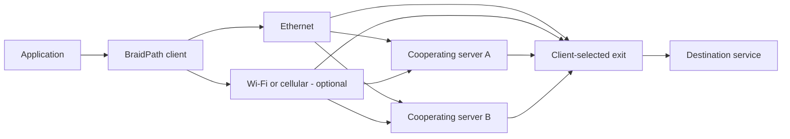

# BraidPath
**Weave paths. Repair loss. Keep latency in check.**

[](https://github.com/LiuTangLei/braidpath/actions/workflows/ci.yml)
[](LICENSE)

[简体中文](README.zh.md) · [Run it](docs/runtime.md) · [Architecture](docs/architecture.md) · [Carrier design](docs/transports.md) · [Validation plan](docs/validation.md) · [Roadmap](docs/roadmap.md)

BraidPath is a Rust multipath transport project combining **forward error correction (FEC), client interface aggregation, and nearby relay entrances**. Its goal is to adapt throughout a long-running session: combine independent path capacity when routes are clear, and preserve useful low-latency delivery when routes become congested.

“Braid” means weaving several imperfect paths into a more resilient connection.

> **Current release: v0.6.2.** TCP proxying uses the aggregate DATAGRAM engine with byte-offset selective acknowledgments, cross-path repair and automatic FEC. Each exit provides a local SOCKS5 listener. Native SOCKS5 UDP supports IPv4 and IPv6 destinations and selects paths using authenticated datagram probes. The default is four cooperating paths. Upgrade clients and servers together; see the [proxy and distributed-server guide](docs/mesh.md).

Version 0.6.2 increases the TCP proxy admission limit, coalesces acknowledgments for established bulk streams during concurrent load, and improves recovery after a rate cut leaves loss unchanged. See the [release notes](docs/releases/v0.6.2.md).

Fixed-target TCP also supports standard mesh discovery and relay leases: use `mesh-server --tcp-target` and `mesh-client --tcp-listen`. This requires no private-network proxy permission; see the [fixed-target guide](docs/mesh.md#fixed-target-tcp-over-the-mesh-v058).

## One interface works. Several can contribute.

For each session, the client chooses an exit; servers have no permanent leader role:



Every server can act as an exit or provide **logical entrances** for another exit. Clients discover members through any server and select an exit; peers forward encrypted traffic toward it. The client and selected exit own that session. Different clients can choose different exits. Each transport path returns through its own entrance. The mesh client currently uses the default local route; the original `client` command retains interface aggregation.

| Client interfaces | Server entrances | Intended use |
| --- | --- | --- |
| One | One | FEC on a single path |
| One | Several | Route diversity where it exists |
| Several | One | Aggregate client access links |
| Several | Several | Schedule across interface–entrance pairs |

Entrance count is not independent capacity. Paths may share the last mile, transit routes, relay backhaul, or the selected exit's uplink. A single interface cannot exceed its access bandwidth by adding entrances.

## Design priorities

- **Repair at the aggregate layer.** Recover across paths without waiting for retransmission when enough timely repair information is available.
- **Keep original data moving.** The encoder emits originals immediately; network transmission still obeys queue limits and congestion control.
- **Treat direction and path quality separately.** Upload quality is not evidence of download quality. A slow path must not create unbounded reordering.
- **Probe without sacrificing an original.** Adaptive mode sends authenticated health probes even while application traffic is idle; probes and feedback share the same traffic budgets as business data.
- **Spend redundancy deliberately.** Measure FEC, retransmission, control traffic, and actual wire cost separately.
- **Make progress measurable.** Compare application P95/P99, deadline misses, completion and goodput under matched conditions. CPU-efficiency optimization comes later.

The UDP tunnel defaults to BBR; `--congestion cubic` selects CUBIC. Proxy clients and mesh servers use BBR in both directions. Adaptive mode adjusts per-path sending allowance using receiver feedback, local queue age and path health. The default local sender-age target is 20 ms. Client `--rate-bps` and server `--max-rate-bps` default to `auto`, with a 10 Gbit/s operational ceiling. Explicit aggregate and bottleneck-group limits remain active during recovery. See the [adaptive policy](docs/runtime.md#adaptive-mode).

Each interface–entrance pair owns an end-to-end Quinn/rustls connection to the selected exit. HTTP/3 serves ordinary requests and authenticates sessions; HTTP Datagrams carry aggregate records. Relays forward encrypted packets to a fixed destination. BraidPath implements its own aggregation core in Rust. See the [carrier design](docs/transports.md).

## Build and run

Use the [official installers](docs/install.md): `install.sh` for Unix and `install.ps1` for Windows. They support version selection, offline installation, checksums and key-preserving removal. Releases provide binaries for 11 platform targets. Download the scripts from the [latest release](https://github.com/LiuTangLei/braidpath/releases/latest), or build locally and install with `--local`.

Rust 1.88 or newer:

```bash
git clone https://github.com/LiuTangLei/braidpath.git
cd braidpath
cargo build --release --locked
./target/release/braidpath --help
cargo test --all-targets --locked
```

Follow the [runtime guide](docs/runtime.md) for credentials, local forwarding, multiple entrances and measurement. The independent in-memory codec example remains available with `cargo run --locked --example loss_recovery`.

| Capability | Status |
| --- | --- |
| XOR `k + 1`, immediate originals, timed partial blocks | Implemented; at most one missing original per block |
| HTTP/3 website, verified server identity, authenticated session joins | Implemented |
| Bidirectional FEC, session deduplication, UDP forwarding | Implemented; negotiated messages up to 4,096 bytes with bounded fragmentation |
| Equal servers, key-based enrollment, discovery and exit selection | Implemented; [operation and limits](docs/mesh.md) |
| Fixed-target opaque relays with source allowlists | Implemented |
| Interface × entrance paths | Ordinary and mesh clients; Linux interface binding and portable source-IP binding |
| Datagram round robin and optional quality-weighted scheduling | Implemented baselines; weighted service is charged on actual admitted bytes |
| Per-flow queues, original-ingress deadlines, admission-based repair credit | Implemented bounded mechanisms |
| Adaptive pacing, sender-age admission, idle health probes and feedback v2 | Implemented opt-in mode |
| Aggregate and explicit bottleneck-group caps | Implemented; configurable aggregate and group limits |
| Startup/outage recovery and explicit session-epoch replacement | Implemented in adaptive mode and mesh clients; bounded backoff and server retention |
| Receiver-local adaptive FEC retention | Implemented as an opt-in bounded policy |
| Two independent bulk repair equations | Opt-in mixed 16+2 mode |
| Reliable ordered TCP over aggregate DATAGRAMs | Implemented; byte SACK, cross-path repair, half-close and bounded cleanup |
| Automatic FEC strength for aggregate TCP | Implemented using qualified receiver loss feedback and bounded repair credit |
| Automatic shared-bottleneck detection and coupled congestion control | Separate research work |
| TUN, reliable-carrier fallback, browser fingerprint shaping | Planned or deferred |

For UDP forwarding, the default repair settings are `--fec 4`, `--block-ms 3` and a 30% repair budget. Mixed FEC can protect small records immediately and encode larger records in separate blocks. The optional `--fec 16 --fec-repairs 2` mode adds two independent bulk repair equations. See [mixed FEC](docs/runtime.md#mixed-small-and-large-record-protection) and [independent FEC](docs/independent-fec.md).

[Packet evidence](docs/statistics.md#bounded-packet-evidence) correlates record and symbol IDs across sender admission, peer reception, decoding and local UDP delivery. Logs use bounded storage and identify incomplete captures.

## Inspiration

We draw inspiration from [Aggligator](https://github.com/remoc-rs/aggligator), especially its link abstraction, dynamic link lifecycle, and observability. BraidPath implements its own aggregation and recovery core.

## Development

```bash
cargo fmt --all -- --check
cargo clippy --all-targets --locked -- -D warnings
cargo test --all-targets --locked
```

Start with small, reproducible changes and explicit acceptance criteria. The [roadmap](docs/roadmap.md) separates codec correctness, network integration, multipath behavior, performance, and deployment readiness.

Test records and run results stay local. The repository contains source code, automated tests, and validation methods. See [CONTRIBUTING.md](CONTRIBUTING.md).

Licensed under [Apache-2.0](LICENSE). See [NOTICE](NOTICE) for attribution.
