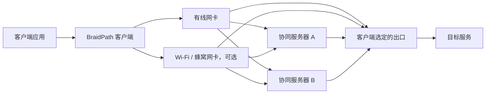

# BraidPath
**Weave paths. Repair loss. Keep latency in check.**

[](https://github.com/LiuTangLei/braidpath/actions/workflows/ci.yml)
[](LICENSE)

[English](README.md) · [运行指南](docs/runtime.md) · [架构设计](docs/architecture.md) · [传输方案](docs/transports.md) · [验证计划](docs/validation.md) · [路线图](docs/roadmap.md)

BraidPath 是一个从零构建的 Rust 多路径传输项目，结合 **前向纠错（FEC）、客户端多网卡聚合和附近的中继入口**。目标是让服务长期运行时自动适应线路：通畅时叠加独立线路的带宽，拥堵时减少排队，保住有用业务的低延迟。

“Braid” 是编织：把多条不完美的路径编成一条更稳定的连接。

> **当前版本：v0.6.2。** TCP 代理通过聚合 DATAGRAM 引擎传输，使用字节偏移 SACK、跨路径补发和自动 FEC。每个出口提供独立的本地 SOCKS5 入口。原生 SOCKS5 UDP 支持 IPv4、IPv6 目标，并通过已认证的数据报探测选择路径。默认使用四条协同路径。服务端与客户端请一并升级，配置见[代理与分布式运行指南](docs/mesh.md)。

v0.6.2 提高了 TCP 代理并发上限，在并发负载下合并长流的确认包，并改善了降速后丢包未变时的发送恢复。详见[版本说明](docs/releases/v0.6.2.md)。

固定目标 TCP 已接入标准 mesh 自动协同：使用 `mesh-server --tcp-target` 与 `mesh-client --tcp-listen`，复用发现、租约和聚合字节流，无需开放任意私网代理权限。见[固定目标接入说明](docs/mesh.md#fixed-target-tcp-over-the-mesh-v058)。

## 一张网卡可以用，多张网卡可以聚合

以下展示一次会话的路径；出口由客户端选择，服务端之间没有固定主从角色：



每台服务器都能成为出口，也能为其他出口提供**逻辑网络入口**。客户端连接任一节点获得目录，选择出口后，其余节点自动提供密文转发路径。选定出口处理该会话的纠错和交付；每条路径的传输回程经过对应入口。不同客户端可以选择不同出口。分布式客户端当前使用默认本地路由；原有 `client` 命令保留多网卡模式。

| 客户端接口 | 服务端入口 | 目标用途 |
| --- | --- | --- |
| 1 | 1 | 单路径也能用 FEC 降低部分丢包的恢复等待 |
| 1 | 多个 | 利用不同入口的路由差异，调度和分散修复流量 |
| 多个 | 1 | 聚合有线、Wi-Fi、蜂窝等客户端路径 |
| 多个 | 多个 | 在“客户端接口 × 服务端入口”之间调度 |

多个入口可能共享客户端最后一公里、运营商路由或所选出口带宽。**入口数量不等于独立带宽数量。** 单网卡多入口不能突破自身接入带宽；路径分散能否改善丢包，必须实测。

## 我们要解决什么

- **丢包后的等待**：在聚合层发出修复信息，争取不等一次重传往返就恢复数据。
- **慢路径拖累**：按预计到达时间、排队、丢包和路径健康状态调度，减少重排等待。
- **空闲后的线路状态未知**：自适应模式在空闲时也发送独立认证探测，业务原包不再是唯一探测手段；探测和反馈使用同一总预算。
- **两端能力不对称**：客户端可以多网卡，所选出口可以通过其他服务器扩展逻辑入口。
- **冗余失控**：分别统计业务数据、FEC、补发与控制流量，用可观测的预算换取延迟收益。
- **“跑得快”缺少证据**：同时检查 P50/P95/P99、完成率、有效吞吐和开销；上下行分别验证，CPU 占用优化后置。

聚合默认在路径间分发不同数据，FEC 修复包按预算发送。

## 构建与运行

提供 [官方安装脚本](docs/install.md)：Unix 使用 `install.sh`，Windows 使用 `install.ps1`。支持版本选择、离线安装、校验和保留密钥的卸载；发布包覆盖 11 个平台目标，可从 [最新版本](https://github.com/LiuTangLei/braidpath/releases/latest) 下载安装脚本，也可从源码构建并通过 `--local` 安装。

UDP 隧道默认使用 BBR，可通过 `--congestion cubic` 选择 CUBIC。代理客户端和 mesh 服务端双向使用 BBR。自适应模式结合接收反馈、本地排队时间和路径健康状态，调整各路径的发送额度；默认本地发送端排队目标为 20 ms。客户端 `--rate-bps` 和服务端 `--max-rate-bps` 默认 `auto`，运行上限为 10 Gbit/s。恢复过程中继续执行总速率与瓶颈分组上限。详见[自适应模式](docs/runtime.md#adaptive-mode)。

需要 Rust 1.88 或更新版本：

```bash
git clone https://github.com/LiuTangLei/braidpath.git
cd braidpath
cargo build --release --locked
./target/release/braidpath --help
cargo test --all-targets --locked
```

凭据、单路径转发、多入口和测量命令见[运行指南](docs/runtime.md)。内存编码示例仍可通过 `cargo run --locked --example loss_recovery` 运行。

| 能力 | 当前状态 |
| --- | --- |
| XOR `k + 1`、立即输出原始包、定时封块 | 已实现；每块最多恢复一个丢失原始包 |
| HTTP/3 页面、服务端证书验证、会话认证 | 已实现 |
| 双向 FEC、会话去重、UDP 转发 | 已实现；协商后单消息最多 4,096 字节，有界分片与重组 |
| 平等服务端、密钥加入、节点发现与客户端选择出口 | 已实现；[分布式指南与边界](docs/mesh.md) |
| 固定目标密文中继、客户端来源白名单 | 已实现 |
| 客户端接口 × 服务端入口 | 普通及分布式客户端均支持；Linux 可绑定接口，各平台可指定本地源 IP |
| UDP 符号轮询与可选的质量加权调度 | 已实现；按实际成功接纳的字节结算权重 |
| 按流排队、原始入口时间过期、按接纳量计修复额度 | 已实现有界机制 |
| 逐路径自适应调速、本地入口年龄准入、空闲探测、第二版反馈 | 已实现可选模式 |
| 总速率与显式共享瓶颈分组上限 | 已实现；可配置总速率与分组上限 |
| 启动失败与断网重连、明确切换新会话代际 | 自适应模式及分布式客户端已实现；重试退避和服务端保留时间有界 |
| 接收侧自适应 FEC 保留时间 | 已实现可选的有界本地策略 |
| 大包双独立修复方程 | 可选混合 16+2 |
| 聚合 DATAGRAM 上的可靠 TCP 字节流 | 已实现；字节 SACK、跨路补发、半关闭和有界回收 |
| TCP 聚合的自动 FEC 强度 | 已实现；使用经过资格确认的接收丢包反馈和有界修复额度 |
| 自动识别共享瓶颈与耦合拥塞控制 | 单独研究 |
| TUN、可靠流承载回退、浏览器指纹整形 | 待实现或后置 |

UDP 转发默认使用 `--fec 4`、`--block-ms 3` 和 30% 修复预算。混合 FEC 可立即保护小记录，并对大记录独立编码。可选的 `--fec 16 --fec-repairs 2` 提供两条独立的大包修复方程。详见[混合 FEC](docs/runtime.md#mixed-small-and-large-record-protection)和[双独立修复](docs/independent-fec.md)。

## 从 Aggligator 学到什么

我们借鉴 [Aggligator](https://github.com/remoc-rs/aggligator) 的多链路抽象、动态链路管理、统一交付与链路统计思路；这些能力会按本项目的 datagram-first 架构逐步实现。

BraidPath 独立实现聚合与修复核心；当前工程基线使用 QUIC DATAGRAM，复用认证加密和拥塞控制，FEC 在聚合层工作。

每条“接口 × 入口”路径使用到所选出口的端到端 Quinn/rustls 连接。HTTP/3 处理网页请求和会话认证，HTTP Datagrams 承载聚合记录；中继向固定目标转发密文。详见[传输方案](docs/transports.md)。

架构、验证计划与路线图使用英文维护。测试记录与运行结果仅在本地保存，仓库保留自动化测试代码和验证方法。

## 开发与参与

```bash
cargo fmt --all -- --check
cargo clippy --all-targets --locked -- -D warnings
cargo test --all-targets --locked
```

欢迎提交可复现的场景、清楚定义的指标和小范围实现。开发要求见 [CONTRIBUTING.md](CONTRIBUTING.md)。

代码按 [Apache-2.0](LICENSE) 许可发布。来源和致谢见 [NOTICE](NOTICE)。
